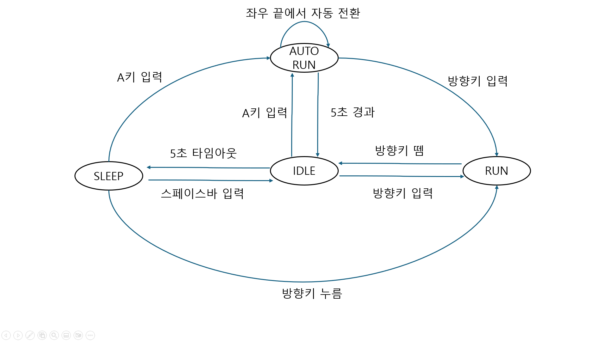

# PRD — Drill #11. 소년 자동 무적 런(AutoRun) 상태 추가

- **과목**: 2D 게임 프로그래밍
- **과제**: Drill #11 (5점)
- **학번**: 2019182041
- **작성일**: 2026-10-27

---

## 1. 개요

`transitions` 라이브러리 기반 상태 머신으로 동작하는 소년 캐릭터 컨트롤러에
**자동 무적 런(AutoRun)** 상태를 추가한다.

기존 캐릭터는 `IDLE` / `SLEEP` / `RUN` 세 상태만 가진다. 여기에 네 번째 상태인
`AUTO_RUN`을 **독립된 상태 클래스**로 추가하여, 키 조작 없이도 소년이 화면을
좌우로 계속 왕복하도록 만든다.

---

## 2. 목표

| # | 목표 | 채점 배점 |
|---|------|----------|
| 1 | `IDLE`에서 `a` 키를 누르면 `AUTO_RUN` 상태로 진입 | 1점 |
| 2 | `AUTO_RUN` 진입 후 5초가 지나면 `IDLE`로 자동 복귀 | 1점 |
| 3 | `AUTO_RUN` 중에는 이동 속도가 빨라지고 캐릭터 크기가 커짐 | 1점 |
| 4 | `AUTO_RUN` 중 화면 좌/우 끝에 닿으면 자동으로 방향 전환 | 1점 |
| 5 | 상태 다이어그램 이미지를 저장소에 포함 | 1점 |

### 부가 요구사항

- `AUTO_RUN` 중 방향키를 누르면 무적 런이 취소되고, 누른 방향의 `RUN` 상태로 전환
- **AutoRun 상태를 반드시 별도 클래스로 구현**
- 기존 버그 수정: `SLEEP` 상태에서 방향키를 눌러도 빠져나오지 못하던 문제

---

## 3. 상태 정의

### 3.1 상태 목록

| 상태 | 설명 | 애니메이션 |
|------|------|-----------|
| `IDLE` | 제자리에서 바라보는 방향으로 대기 | 보행 시트 8프레임 반복 |
| `SLEEP` | 취침. 캐릭터가 앞으로 90도 누움 | 정지 프레임 + 회전 렌더링 |
| `RUN` | 방향키를 누르고 있는 동안 좌/우 이동 | 달리기 시트 8프레임 반복 |
| `AUTO_RUN` | 키 입력 없이 자동 좌우 왕복. 고속 + 확대 | 달리기 시트 8프레임 반복 |

### 3.2 상태 전이표

| From | Event | To | 비고 |
|------|-------|----|------|
| `IDLE` | 5초 경과 | `SLEEP` | 타이머 만료 |
| `IDLE` | 방향키 누름 | `RUN` | 누른 방향으로 `face_dir` 설정 |
| `IDLE` | `a` 키 누름 | `AUTO_RUN` | 무적 런 진입 |
| `SLEEP` | `SPACE` 누름 | `IDLE` | 타이머 리셋 |
| `SLEEP` | 방향키 누름 | `RUN` | **버그 수정 항목** |
| `SLEEP` | `a` 키 누름 | `AUTO_RUN` | 취침 중에도 바로 무적 런 |
| `RUN` | 방향키 뗌 | `IDLE` | 타이머 리셋 |
| `AUTO_RUN` | 5초 경과 | `IDLE` | 타이머 만료 |
| `AUTO_RUN` | 방향키 누름 | `RUN` | 무적 런 취소 |

### 3.3 상태 다이어그램



---

## 4. 기능 명세

### 4.1 AutoRun 상태 (`AutoRunState`)

| 항목 | 값 | 설명 |
|------|-----|------|
| 이동 속도 | `RUN`의 3배 (`5 → 15 px/frame`) | 진입 시 즉시 적용 |
| 캐릭터 크기 | `100 → 160 px` (1.6배) | `clip_composite_draw` 로 확대 |
| 지속 시간 | 5초 | 경과 시 `IDLE` 복귀 |
| 경계 처리 | 좌/우 끝 도달 시 `face_dir` 반전 | 화면 밖으로 나가지 않음 |

#### Entry action
- 진입 시각 기록 (5초 타이머 시작)
- 프레임 인덱스 초기화

#### Do activity (매 프레임)
1. 애니메이션 프레임 갱신
2. `x += AUTO_RUN_SPEED * face_dir`
3. 좌/우 경계 도달 검사 → 도달 시 `face_dir *= -1`
4. 경과 시간 5초 초과 → `IDLE`로 전이

#### Draw
- 바라보는 방향에 맞는 달리기 행을 선택
- `clip_composite_draw`로 `AUTO_RUN_SIZE` 크기로 확대 렌더링

### 4.2 기존 버그 수정

**현상**: `SLEEP` 상태에서 방향키를 눌러도 아무 반응이 없어 `SPACE`를 누르기
전까지 영원히 `SLEEP`에 머무름.

**원인**: `go_to_run` 트랜지션의 source가 `IDLE` 하나로만 등록되어 있어
`SLEEP` 상태에서는 트리거가 무시됨 (`transitions`의 `MachineError`).

**수정**: `go_to_run`의 source에 `SLEEP`과 `AUTO_RUN`을 추가하여
`['IDLE', 'SLEEP', 'AUTO_RUN'] → 'RUN'` 으로 변경.

---

## 5. 아키텍처

### 5.1 파일 구성

```
drill11/
├── main.py               # 게임 루프, 이벤트 분배, 월드 관리
├── boy.py                # Boy 캐릭터 + 상태 머신 조립
├── state.py              # 상태 클래스 (BoyState 및 4개 구체 상태)
├── grass.py              # 배경 잔디 오브젝트
├── animation_sheet.png   # 소년 스프라이트 시트
├── grass.png             # 잔디 이미지
├── state_diagram.png     # 상태 다이어그램 (제출물)
├── PRD.md                # 본 문서
└── README.md             # 실행 방법 안내
```

### 5.2 상태 클래스 설계

`transitions.State`를 상속한 `BoyState`를 베이스로 두고, 각 상태가
자신의 **진입 / 퇴장 / 매 프레임 동작 / 렌더링**을 직접 책임진다.

```
transitions.State
└── BoyState            (enter/exit 훅을 start/finish 로 위임)
    ├── IdleState       do: 프레임 갱신 + 5초 타이머 → SLEEP
    ├── SleepState      draw: 90도 회전 렌더링
    ├── RunState        do: 이동 + 경계 클램핑
    └── AutoRunState    do: 고속 이동 + 자동 반전 + 5초 타이머 → IDLE
```

`Boy`는 상태 객체를 보관하지 않고, `self.machine.get_state(self.state)`로
현재 상태 객체를 조회하여 `do()` / `draw()`를 위임한다.

### 5.3 스프라이트 시트 좌표

`animation_sheet.png` — 100×100px, 8프레임 × 4행 (pico2d는 y축이 아래 기준)

| y | 내용 |
|---|------|
| 300 | 우측 바라보며 대기(보행) |
| 200 | 좌측 바라보며 대기(보행) |
| 100 | 우측 달리기 |
| 0 | 좌측 달리기 |

---

## 6. 조작법

| 키 | 동작 |
|----|------|
| `→` / `←` | 해당 방향으로 달리기 (`RUN`) |
| `a` | 자동 무적 런 진입 (`IDLE` / `SLEEP` 에서) |
| `SPACE` | 취침 상태에서 깨어나기 (`SLEEP → IDLE`) |
| `ESC` | 게임 종료 |

---

## 7. 실행 환경

- Python 3.x
- `pico2d`
- `transitions` (`pip install transitions`)

```bash
python main.py
```

---

## 8. 검증 시나리오

| # | 시나리오 | 기대 결과 |
|---|----------|----------|
| 1 | 실행 후 5초 대기 | `SLEEP`으로 전환, 캐릭터가 누움 |
| 2 | `SLEEP`에서 `SPACE` | `IDLE` 복귀, 타이머 리셋 |
| 3 | `SLEEP`에서 방향키 | `RUN`으로 전환 (버그 수정 확인) |
| 3-B | `SLEEP`에서 `a` | `AUTO_RUN`으로 바로 전환 |
| 4 | `IDLE`에서 `a` | `AUTO_RUN` 진입, 크기 확대 + 고속 이동 |
| 5 | `AUTO_RUN` 중 화면 끝 도달 | 방향 반전 후 반대쪽으로 이동 |
| 6 | `AUTO_RUN` 진입 후 5초 대기 | `IDLE` 복귀, 크기 원복 |
| 7 | `AUTO_RUN` 중 방향키 | 누른 방향의 `RUN`으로 전환, 크기 원복 |
